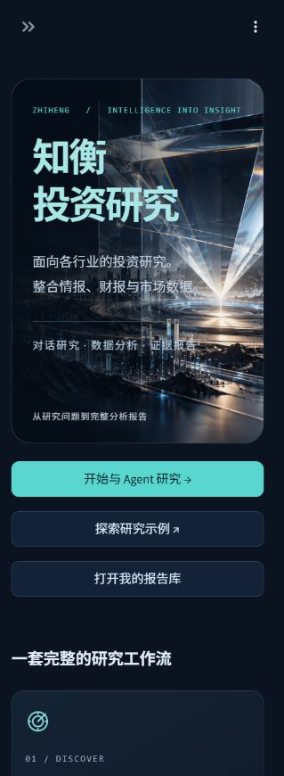

# 知衡 · AI Investment Research Agent

**面向中国市场各行业的投资研究 Agent。**



本地中文投资研究工作台。产品首页介绍研究流程，一键进入 Agent 对话、研究示例或报告库。按问题选择数据工具与专业方法，展示财务趋势、来源、研究盲区和有条件的判断。投资风格默认价值投资，可选择成长、短线、事件驱动或综合研究。

产品支持跨行业研究；AI、机器人与前沿科技是本仓库选用的公开展示案例，不是产品的行业限定。具体覆盖程度取决于实际取得的数据和已验证的专业方法。

## 主要能力

- **对话研究**：持久化会话、后台任务、停止与中断恢复；桌面对话区与可收起证据侧栏约为 7:3。
- **完整研究报告**：对话中显示结论节选与阅读入口；独立报告页保留正文、财务趋势、K 线、股票对比、原文与覆盖检查。只展示本次保存的数据，缺失图表明确提示。
- **历史与导出**：报告自动保存本机，支持搜索、收藏、回看与 PDF / Markdown 导出；PDF 包含中文正文、可用图表、财务明细、覆盖记录与原文链接。网页互动不调用模型，导出也不请求新数据。
- **专业方法**：14 个版本化 Skills，涵盖财务质量、资本配置、三表情景、估值、统计、组合、政策、治理与反证。公式交给 Python，解释交给模型。
- **公司财务**：公开三表及官方年报补查，累计季度拆分与 TTM、杜邦、现金质量和附注线索。三表情景、DCF 敏感性与股权桥接可编辑重算。
- **行业研究**：候选池上限 500、初筛比较前 20、深研最多 5；显示实际取得数量、日期及淘汰原因，不宣称覆盖全市场。
- **前沿情报**：八个领域的事件、来源、人物观点、主题演进及关注；与股票研究共用证据。
- **多视角审阅**：适配 TradingAgents-CN 的 8 类 Apache-2.0 角色方法，按任务选择，而非每次运行全部角色。

数据不足时允许“暂不推荐”。研究覆盖不代表成功概率；计算通过也不表示假设已验证。当前为单用户本地应用，不是公网多租户服务。

## 启动

```bash
git clone https://github.com/Chenzkkkk/AI-Investment-Research-Agent.git
cd AI-Investment-Research-Agent
conda env create -f environment.yml
conda activate investment-agent
python -m streamlit run app.py
```

已有 `investment-agent` 环境时先检查并复用，再在该环境执行 `python -m pip install -r requirements.txt`。不要安装到 base。

浏览 http://127.0.0.1:8501 。把 `.env.example` 复制为 `.env` 并在本机配置自己的模型凭证。DeepSeek 默认 `deepseek-flash`、推理 `high`，推理强度可在网页切换；模型和地址以账号支持情况为准。模型调用可能产生供应商费用。

公开数据默认启用，妙想可选并需自己的权限，Choice 默认关闭。第三方 SDK、账号激活文件、妙想供应商脚本和私有数据不随仓库分发。读取已有报告或浏览情报不触发模型。

## 可以这样问

- 机器人产业哪些公司已实现商业化？比较现金流、竞争、估值和风险。
- 分析工业富联的财务质量，指出我最容易忽略的三个问题。
- 最近的新产品中，哪些可能改变小企业的工作方式？保留原始出处。
- 我的研究组合集中在哪些行业？按我提供的真实持仓和收益数据做压力情景。

## 验证与边界

```bash
python -m pytest tests -q
python -m investment_agent.intelligence.worker
```

第二条命令只执行一轮到期情报任务；定时采集需另行配置。研究任务在本地网页服务存活时后台执行，服务重启后显式继续；不是云端常驻执行。会话数据库、研究快照和导出文件都在本机 `data/` 下；自动保存不是云备份，不应删除该目录。

当前可执行范围及限制见 [专业能力与验收](docs/professional-workspace.md)、[架构](docs/architecture.md)、[数据边界](docs/data-policy.md)。金融企业估值、扫描财报 OCR、完整历史修订库和全市场无幸存者偏差评估尚未完成。PDF 解析是有限字段和页数的辅助流程，不能等同于完整审计。

基础设施为 Streamlit、Plotly、LangGraph、SQLite WAL、DuckDB、httpx、feedparser、Trafilatura、pdfplumber、ReportLab。PDF 优先使用本机中文字体，缺少字体时回退到标准 CJK 字体；不再分发系统字体。首页主视觉为项目生成的概念图，不是行情数据。免费路线使用已验证公开接口及 AKShare/BaoStock；公开可访问不等于有保证的官方 API 或可任意再分发。

方法覆盖参考 [CFA CBOK](https://www.cfainstitute.org/programs/cfa-program/candidate-resources/cbok)，不宣称 CFA 认证。适配的上游方法详见 [许可与复用清单](docs/upstream-reuse.md)、[TradingAgents-CN](https://github.com/hsliuping/TradingAgents-CN)。财务计算为本项目依据公开方法独立实现。

本项目用于研究，不连接交易执行。个人问题、报告、账户和数据库保留本地；公开科技示例为单独审查的有日期研究，不能视为实时推荐或投资收益。
